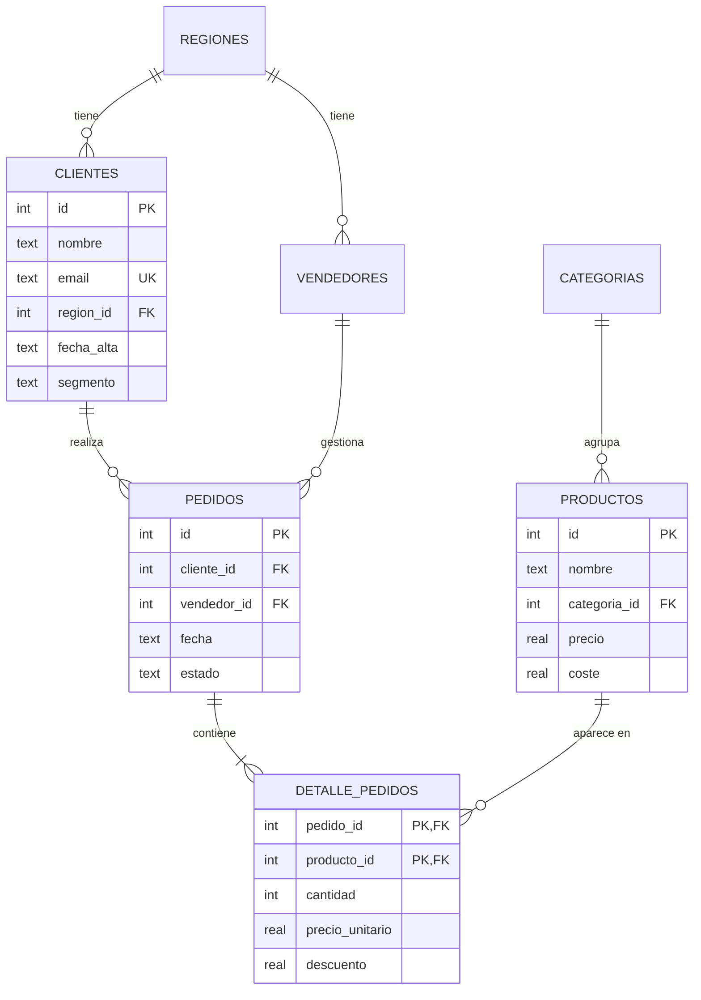

# Sistema de análisis de ventas con SQL

*[English version](README.md)*

Proyecto de portafolio que muestra el ciclo completo de un análisis de datos con SQL:

1. **Diseño de una base de datos relacional** (SQLite) con claves primarias y foráneas, restricciones `CHECK`, índices y una vista.
2. **Carga de datos** de ventas de una empresa ficticia (2 años, 5.000 pedidos).
3. **12 consultas de análisis**, desde agregaciones básicas hasta funciones de ventana, CTE, cohortes y segmentación RFM.
4. **Un informe automático** con tablas, conclusiones y recomendaciones de negocio: [`reports/informe.md`](reports/informe.md).

Solo usa la biblioteca estándar de Python, así que no hay que instalar nada.

## Cómo ejecutarlo

```bash
python3 main.py                        # crea ventas.db y genera reports/informe.md
python3 -m unittest discover tests -v  # ejecuta las pruebas
```

Para explorar la base de datos a mano: `sqlite3 ventas.db` (o cualquier cliente como DB Browser for SQLite).

## Modelo de datos



- El esquema está en [`sql/01_esquema.sql`](sql/01_esquema.sql).
- La vista `v_ventas_detalle` ([`sql/02_vistas.sql`](sql/02_vistas.sql)) une todas las tablas y calcula el importe neto y el coste de cada línea. Así las consultas de análisis quedan más cortas y legibles.

## Análisis incluidos

| # | Análisis | Técnicas SQL |
|---|---|---|
| 01 | Indicadores clave (KPIs) | Agregaciones, subconsultas, `CASE` dentro de `SUM` |
| 02 | Evolución mensual | CTE, `strftime`, `LAG` (mes anterior y mismo mes del año anterior) |
| 03 | Productos más vendidos | `RANK()`, `SUM() OVER ()` para el % del total |
| 04 | Rentabilidad por categoría | Margen bruto, % de ingresos frente a % de beneficio |
| 05 | Ventas por región | `LEFT JOIN` desde la dimensión, `COUNT(DISTINCT)` |
| 06 | Concentración de clientes (Pareto) | `ROW_NUMBER`, suma acumulada con `ROWS BETWEEN` |
| 07 | Segmentación RFM | CTE encadenadas, `julianday`, `NTILE(4)`, `CASE` |
| 08 | Retención por cohortes | Cohortes trimestrales, `EXISTS` correlacionado, `date()` |
| 09 | Estacionalidad mensual | `VALUES` como tabla, índice estacional con `AVG() OVER ()` |
| 10 | Día de la semana | `strftime('%w')`, orden personalizado |
| 11 | Rendimiento comercial | Dos CTE combinadas, comparación con la media del equipo |
| 12 | Productos sin ventas | Anti-join con `NOT EXISTS` |

Cada archivo de [`sql/analisis/`](sql/analisis/) empieza con la pregunta de negocio que responde.

## Principales hallazgos

*(Resumen del informe; las cifras exactas están en [`reports/informe.md`](reports/informe.md).)*

- **Crecimiento:** las ventas de 2025 superan a las de 2024 en torno a un 20 %.
- **Volumen sin rentabilidad:** Electrónica aporta casi la mitad de los ingresos, pero su margen es del ~5 % y solo genera ~17 % del beneficio.
- **Dependencia de pocos clientes:** el 20 % de los clientes genera más del 70 % de los ingresos, y los mejores son todos empresas.
- **Clientes en riesgo:** unos 50 clientes que compraban a menudo llevan meses sin hacerlo.
- **Estacionalidad marcada:** diciembre vende un 70 % más que un mes medio; julio y agosto, un 30 % menos.
- **Equipo comercial:** un vendedor factura casi la mitad que la media y triplica la tasa de cancelaciones.
- **Catálogo:** 3 productos nunca se han vendido.

## Estructura del proyecto

```
sistema-ventas/
├── main.py                 # ejecuta todo el proceso
├── sql/
│   ├── 01_esquema.sql      # tablas, restricciones e índices
│   ├── 02_vistas.sql       # vista v_ventas_detalle
│   └── analisis/           # una consulta por pregunta de negocio
├── src/
│   ├── generar_datos.py    # datos ficticios reproducibles (semilla fija)
│   ├── base_datos.py       # conexión, carga y ejecución de consultas
│   └── informe.py          # informe Markdown y conclusiones
├── reports/informe.md      # resultado generado
└── tests/test_sistema.py   # pruebas con unittest
```

## Sobre los datos

Los datos son **ficticios** y se generan con una semilla fija, así que siempre son los mismos. Incluyen patrones realistas a propósito (estacionalidad, crecimiento, distribución de Pareto en clientes, categorías con márgenes muy distintos, un vendedor con bajo rendimiento y productos sin ventas) para que el análisis tenga algo que descubrir. Las conclusiones del informe se calculan a partir de los resultados de las consultas, no están escritas a mano.
