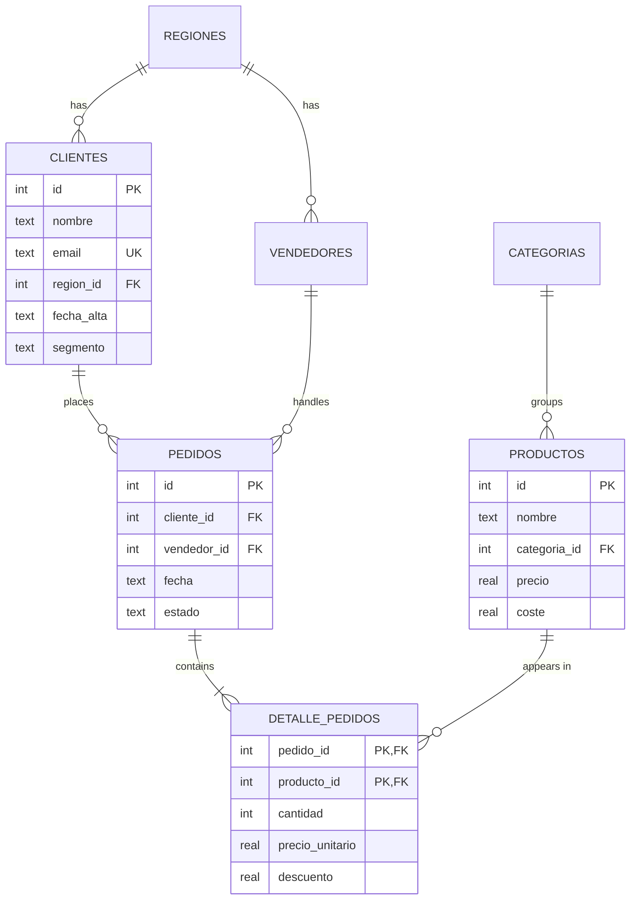

# Sales Analysis System with SQL

*[Versión en español](README.es.md)*

A portfolio project that covers the full cycle of a data analysis with SQL:

1. **Relational database design** (SQLite) with primary and foreign keys, `CHECK` constraints, indexes and a view.
2. **Data loading** for a fictional company's sales (2 years, 5,000 orders).
3. **12 analysis queries**, from basic aggregations to window functions, CTEs, cohort analysis and RFM segmentation.
4. **An automated report** with tables, conclusions and business recommendations: [`reports/informe.md`](reports/informe.md).

It only uses the Python standard library, so there is nothing to install.

> **Note:** the code, table names and the generated report are in Spanish. Key terms: *ventas* = sales, *pedidos* = orders, *clientes* = customers, *productos* = products, *vendedores* = sales reps, *ingresos* = revenue, *margen* = margin, *informe* = report.

## How to run it

```bash
python3 main.py                        # creates ventas.db and generates reports/informe.md
python3 -m unittest discover tests -v  # runs the tests
```

To explore the database by hand: `sqlite3 ventas.db` (or any client such as DB Browser for SQLite).

## Data model



- The schema is in [`sql/01_esquema.sql`](sql/01_esquema.sql).
- The `v_ventas_detalle` view ([`sql/02_vistas.sql`](sql/02_vistas.sql)) joins all the tables and calculates the net amount and cost of each order line, which keeps the analysis queries short and readable.

## Analyses included

| # | Analysis | SQL techniques |
|---|---|---|
| 01 | Key performance indicators (KPIs) | Aggregations, subqueries, `CASE` inside `SUM` |
| 02 | Monthly trend | CTE, `strftime`, `LAG` (previous month and same month last year) |
| 03 | Best-selling products | `RANK()`, `SUM() OVER ()` for share of total |
| 04 | Profitability by category | Gross margin, share of revenue vs. share of profit |
| 05 | Sales by region | `LEFT JOIN` from the dimension table, `COUNT(DISTINCT)` |
| 06 | Customer concentration (Pareto) | `ROW_NUMBER`, running total with `ROWS BETWEEN` |
| 07 | RFM segmentation | Chained CTEs, `julianday`, `NTILE(4)`, `CASE` |
| 08 | Cohort retention | Quarterly cohorts, correlated `EXISTS`, `date()` |
| 09 | Monthly seasonality | `VALUES` as a table, seasonal index with `AVG() OVER ()` |
| 10 | Day of the week | `strftime('%w')`, custom ordering |
| 11 | Sales team performance | Two combined CTEs, comparison with the team average |
| 12 | Products with no sales | Anti-join with `NOT EXISTS` |

Each file in [`sql/analisis/`](sql/analisis/) starts with the business question it answers.

## Key findings

*(Summary of the report; exact figures are in [`reports/informe.md`](reports/informe.md).)*

- **Growth:** 2025 sales are about 20% higher than 2024.
- **Volume without profitability:** Electronics brings in almost half of the revenue, but its margin is ~5% and it generates only ~17% of gross profit.
- **Dependence on a few customers:** 20% of customers generate more than 70% of revenue, and the top customers are all businesses.
- **Customers at risk:** about 50 customers who used to buy often have not purchased in months.
- **Strong seasonality:** December sells 70% more than an average month; July and August around 30% less.
- **Sales team:** one sales rep bills almost half the team average and has three times the cancellation rate.
- **Catalogue:** 3 products have never been sold.

## Project structure

```
sistema-ventas/
├── main.py                 # runs the whole process
├── sql/
│   ├── 01_esquema.sql      # tables, constraints and indexes
│   ├── 02_vistas.sql       # v_ventas_detalle view
│   └── analisis/           # one query per business question
├── src/
│   ├── generar_datos.py    # reproducible fictional data (fixed seed)
│   ├── base_datos.py       # connection, loading and query execution
│   └── informe.py          # Markdown report and conclusions
├── reports/informe.md      # generated output
└── tests/test_sistema.py   # tests with unittest
```

## About the data

The data is **fictional** and generated with a fixed seed, so it is always the same. It deliberately includes realistic patterns (seasonality, growth, a Pareto distribution of customers, categories with very different margins, an underperforming sales rep and products with no sales) so the analysis has something to discover. The conclusions in the report are calculated from the query results, not written by hand.
